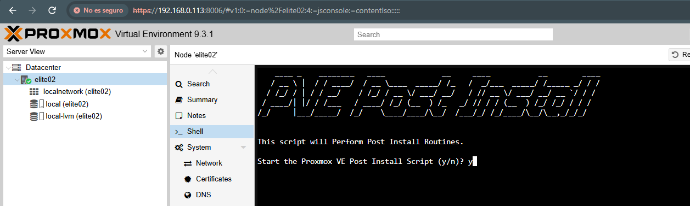

# TECHNICAL LOG & AUTOMATION ENGINEERING GUIDE

## Configuring PBS From Scratch (This script must be run on Proxmox Backup Server.)
## Automated ZFS Pool & PBS Datastore Creator
**Miguelangel Luna**
---

## CONTENT:

[Comunity Scripts](https://community-scripts.org/scripts/post-pbs-install?id=post-pbs-install&category=Proxmox%20&%20Virtualization=)

## 1. Introduction and Theoretical Framework:

**This scripts (prepare.sh)**: create a datastore and prepare the physical disk in **RAID 1** or alone if you want.

## Context and problem:


## Variables (User Input):

Variable	Origen	Descripción	Ejemplo / Valores:

## Key Funcionalities:

**Intelligent OS Detection:** Uses **lsblk** and **findmnt** to identify the physical disk hosting the root partition (even on LVM) to ensure it is never formatted by mistake.

## Use Case:

Use this script when you 

## Logic & Flow:

**Verification:** Checks the health of the pool and confirms registration within the PBS environment.


## 2. IMPLEMENTATION:

This script provides options for managing Proxmox VE repositories, including disabling the Enterprise Repo, adding or correcting PVE sources, enabling the No-Subscription Repo, adding the test Repo, disabling the subscription nag, updating Proxmox VE, and rebooting the system.

**2.1)** Run the following command:

```text
bash -c "$(curl -fsSL https://raw.githubusercontent.com/community-scripts/ProxmoxVE/main/tools/pve/post-pve-install.sh)"
```




