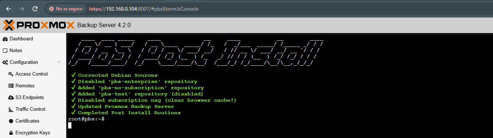

# TECHNICAL LOG & AUTOMATION ENGINEERING GUIDE

## Configuring PBS From Scratch
**CCNP Miguelangel Luna**

---

## CONTENT:

| Case | Title | Description |
| :--- | :--- | :--- |
| **01** | [Claude & n8n AI Agents](./case-01-Google-Auth/) | Agentes Claude . |

[Comunity Scripts](https://community-scripts.org/scripts/post-pbs-install?id=post-pbs-install&category=Proxmox%20&%20Virtualization=)

## 1. Introduction and Theoretical Framework

**Proxmox Backup Server:** Performs backup and restoration of VMs, containers, and physical hosts, and is characterized by its high efficiency, security, and support for off-site storage.

## 2. Topology and BGP Neighbor Establishment


## 3. IMPLEMENTATION:

The script is designed for Proxmox Backup Server (PBS) and will give options to Disable the Enterprise Repo, Add/Correct PBS Sources, Enable the No-Subscription Repo, Add Test Repo, Disable Subscription Nag, Update Proxmox Backup Server and Reboot PBS:

**1.1)** Run the following command:

```text
bash -c "$(curl -fsSL https://raw.githubusercontent.com/community-scripts/ProxmoxVE/main/tools/pve/post-pbs-install.sh)"
```



**1.2) This scripts (prepare.sh), create a datastore and prepare the physical disk in RAID 1 or alone if you want.**

```text
cd csr1kv
```


